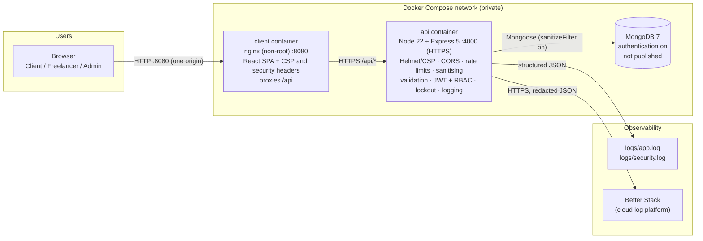
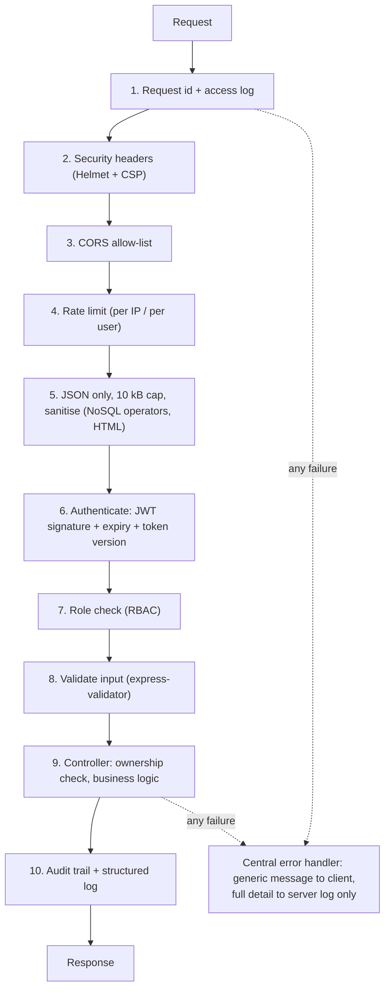
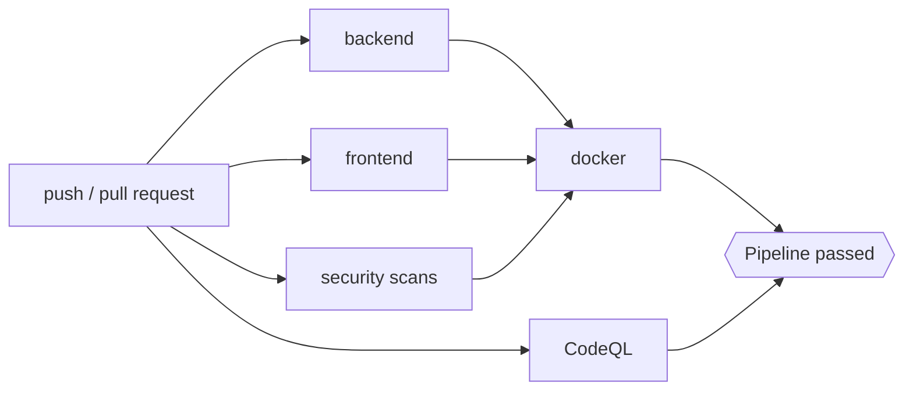

# HustleHub+ - Final POE (DevSecOps, Monitoring and Finalisation)

**Module:** INSY7314 / APDS7311 - Information Systems 3D, Application Development Security  
**Stack:** MongoDB · Express 5 · React 18 · Node.js 22 · Docker · GitHub Actions

HustleHub+ is a secure freelance marketplace. Freelancers advertise gigs priced in rand, clients book them, and every booking creates a simulated payment (a *transaction*) that counts as the freelancer's income. This final part adds what turns the Part 2 application into a deployable, monitored system:

| Final-part requirement | Where it is documented |
|---|---|
| Tax estimation + income dashboard | [Section 4](#4-tax-estimation-and-income-dashboard) |
| CI/CD pipeline with GitHub Actions | [Section 8](#8-cicd-pipeline) |
| Static code analysis | [Section 9](#9-static-code-analysis) |
| Docker + Docker Compose | [Section 10](#10-docker-and-docker-compose) |
| Logging and monitoring | [Section 7](#7-logging-and-monitoring) |
| Two or more extra security features (three delivered) | [Section 5.2](#52-own-security-features-beyond-the-minimum) |
| Final security review | [Section 6](#6-final-security-review) |
| Setup, testing, pipeline, evidence | Sections [2](#2-getting-started), [3](#3-testing), [11](#11-evidence) |

---

## Table of contents

1. [System overview and architecture](#1-system-overview-and-architecture)
2. [Getting started](#2-getting-started)
3. [Testing](#3-testing)
4. [Tax estimation and income dashboard](#4-tax-estimation-and-income-dashboard)
5. [Security implementation](#5-security-implementation)
6. [Final security review](#6-final-security-review)
7. [Logging and monitoring](#7-logging-and-monitoring)
8. [CI/CD pipeline](#8-cicd-pipeline)
9. [Static code analysis](#9-static-code-analysis)
10. [Docker and Docker Compose](#10-docker-and-docker-compose)
11. [Evidence](#11-evidence)
12. [Progression from Part 1 and Part 2](#12-progression-from-part-1-and-part-2)
13. [Known limitations](#13-known-limitations)
14. [References](#14-references)

---

## 1. System overview and architecture

### 1.1 Users and what they can do

| Role | Capabilities |
|---|---|
| **Client** | Register, sign in, browse gigs, book a gig (simulated payment), view their own bookings and payments |
| **Freelancer** | Create, edit, delete and view **their own** gigs, view bookings on them, view income, **estimated tax and the income dashboard** |
| **Admin** | View all gigs, bookings and transactions, delete any gig (moderation), **read the security audit log** |

Each booking creates a `Booking` and a `Transaction` linked to the client and the freelancer. A freelancer's income is the sum of their transactions.

### 1.2 Architecture



**System boundaries.** Only two ports are published: the web app on `8080`, and the API on `127.0.0.1:4000` (loopback only, used for Postman/Newman). MongoDB has no published port and requires a username and password, so it is reachable only from the API container. The browser only ever talks to one origin (the nginx container), which removes CORS and certificate-warning problems.

### 1.3 Request flow through the API

Every request passes the same ordered checks. The order matters: cheap rejections come first.



### 1.4 Project structure

```
.
├── docker-compose.yml            MongoDB + API + client
├── .env.example                  Compose settings (copy to .env)
├── .github/
│   ├── workflows/ci.yml          CI/CD pipeline
│   └── dependabot.yml            weekly dependency update PRs
├── hustlehub-plus-api/
│   ├── Dockerfile  docker-entrypoint.sh  healthcheck.js  .dockerignore
│   ├── index.js                  app setup, middleware order, startup/shutdown
│   ├── config/                   db.js · logger.js · taxTables.js
│   ├── routes/                   auth · gigs · bookings · transactions · admin
│   ├── controllers/              auth · gig · booking · transaction · admin
│   ├── middleware/               authenticateToken · rateLimiters · securityHeaders ·
│   │                             sanitizeRequest · validate · errorHandler · requestLogger ...
│   ├── models/                   User · Gig · Booking · Transaction · AuditLog
│   ├── validators/               express-validator rules per resource
│   ├── utils/                    tax.js · dashboard.js · audit.js · sanitize.js
│   ├── tests/                    104 Jest tests (8 suites)
│   ├── postman/                  Final collection (147 requests, 587 assertions) + environment
│   └── eslint.config.js  jest.config.js
├── hustlehub-plus-client/
│   ├── Dockerfile  nginx.conf  .dockerignore
│   └── src/                      App · AuthPage · pages · dashboard · adminPages · shared · tests
└── docs/evidence/                test, scan, Newman and log output (see Section 11)
```

---

## 2. Getting started

### 2.1 Option A - Docker (recommended)

Prerequisites: Docker Desktop (or Docker Engine with the Compose plugin).

```bash
cp .env.example .env          # Windows cmd: copy .env.example .env
# edit .env: set MONGO_ROOT_PASSWORD, JWT_SECRET (32+ random characters) and ADMIN_PASSWORD
docker compose up -d --build --wait
```

Generate a strong signing secret:

```bash
node -e "console.log(require('crypto').randomBytes(48).toString('hex'))"
```

| What | Address |
|---|---|
| Web app | http://localhost:8080 |
| API health check | `curl -k https://localhost:4000/health` → `{"status":"OK","protocol":"HTTPS"}` |
| Admin sign-in | the `ADMIN_EMAIL` / `ADMIN_PASSWORD` from `.env` (created automatically on first start) |

Useful commands:

```bash
docker compose ps                  # all three services should be "healthy"
docker compose logs -f api         # live structured logs
docker compose down                # stop (data is kept in the mongo-data volume)
docker compose down -v             # stop and DELETE all data
```

### 2.2 Option B - run locally without Docker

Prerequisites: Node.js 20+ and MongoDB running locally (or an Atlas URI in `MONGO_URI`).

**Backend**

```bash
cd hustlehub-plus-api
npm install
cp .env.example .env                      # Windows cmd: copy .env.example .env  - then set JWT_SECRET
mkdir certs
openssl req -x509 -newkey rsa:2048 -nodes -days 365 -subj "/CN=localhost" \
  -keyout certs/localhost-key.pem -out certs/localhost-cert.pem
npm run seed:admin
npm start
```

**Frontend** (second terminal)

```bash
cd hustlehub-plus-client
npm install
npm run dev                               # http://localhost:5173
```

Port 5173 must be free because the API's CORS allow-list is `CLIENT_ORIGIN=http://localhost:5173`. Vite proxies `/api` to the HTTPS API, so the browser never sees the self-signed certificate.

### 2.3 Environment variables (API)

| Variable | Purpose | Default |
|---|---|---|
| `JWT_SECRET` | Token signing secret (32+ characters; the API refuses to start in production without it) | - |
| `MONGO_URI` | MongoDB connection string | - |
| `USE_HTTPS`, `SSL_KEY_PATH`, `SSL_CERT_PATH` | Serve over HTTPS with the given certificate | `true` |
| `CLIENT_ORIGIN` | The only origin CORS allows | `http://localhost:5173` |
| `ACCOUNT_LOCK_THRESHOLD` / `ACCOUNT_LOCK_MINUTES` | Failed sign-ins before lockout / lock length | `5` / `15` |
| `AUDIT_RETENTION_DAYS` | Audit entries are auto-deleted after this | `90` |
| `LOG_LEVEL`, `LOG_TO_FILE`, `LOG_DIR` | Logging behaviour | `info`, `true`, `./logs` |
| `LOGTAIL_SOURCE_TOKEN`, `LOGTAIL_INGESTING_HOST` | Enable cloud logging (Better Stack) | disabled |
| `RATE_LIMIT_*` | Rate-limit overrides (see `.env.example`) | see Section 5.1 |

---

## 3. Testing

There are four layers of automated testing, and all of them run in the pipeline.

| Layer | Tool | Size | Result |
|---|---|---|---|
| Backend unit / component tests | Jest + Supertest | 8 suites, **104 tests** | all pass, **91.7 %** statement coverage |
| API endpoint tests | Postman collection run with **Newman** | 14 folders, **147 requests, 587 assertions** | **0 failed** |
| Frontend tests | Vitest + React Testing Library | 6 files, **58 tests** | all pass, **83.1 %** statement coverage |
| Static analysis | ESLint (+ security plugin), CodeQL, Trivy, Hadolint, `npm audit` | see [Section 9](#9-static-code-analysis) | 0 open findings |

### 3.1 Backend unit tests

```bash
cd hustlehub-plus-api
npm test                 # run
npm run test:coverage    # run + coverage (the build fails below 80 % statements/lines/functions, 70 % branches)
```

The models are mocked, so no database is needed. What is covered:

| Suite | What it proves |
|---|---|
| `tax.test.js` | Tax maths against SARS's own published bracket figures; threshold edges (R95 750 / R99 000); rebate; monotonic tax; rounding; invalid input; tax-year boundaries (28 Feb / 1 Mar); projection rules |
| `dashboard.test.js` | March-to-February month order, income grouping per gig, top-5 limit, cent rounding, removed gigs, empty year |
| `authenticateToken.test.js` | Missing/wrong-scheme/forged/expired/`alg:none`/HS512 tokens rejected; **revoked tokens rejected**; role re-read from the database; bad ids rejected before any query |
| `authController.test.js` | Login token payload; **lockout threshold, lock duration, locked + correct password still refused**; unknown-email response identical to wrong password; logout bumps the token version; only a bcrypt hash is stored |
| `api.test.js` | Real Express app over HTTP: headers/CSP, 404/415/malformed JSON leak nothing, RBAC (`403`) on the dashboard and audit routes, query validation (`400`), operator injection in the query string, DB errors do not leak |
| `audit.test.js` | Audit helper redacts secrets, never throws when the database write fails, hashed e-mail subject |
| `logger.test.js` | Secrets redacted at any depth, truncation, depth and array caps |
| `transactionController.test.js` | Data scoped by role; income aggregate |

### 3.2 API endpoint tests (Postman + Newman)

The collection `hustlehub-plus-api/postman/HustleHub-Plus-Final.postman_collection.json` extends the Part 2 collection with three new folders:

| Folder | Covers |
|---|---|
| `10 Income Dashboard & Tax Estimate` | Correct totals, 12 monthly buckets that add up, tax maths re-computed inside the test, other freelancers see only their own (zero) income, invalid/repeated/script `taxYear` rejected and not echoed, **Client and Admin get 403**, no token 401 |
| `11 Own Security Features` | Logout revokes a token (old token then returns 403 with the generic message, a fresh login works), three wrong passwords lock the account, the **correct password is then refused with 423** and no token is issued |
| `12 Admin Audit Trail` | Admin sees auth/booking/transaction events newest-first, filtering, lockout was audited, **no passwords, tokens or e-mail addresses in the trail**, Freelancer/Client 403, limit/event validation |

A collection-level script additionally scans **every response** for stack traces, file paths and database error text.

Run it (restart the API first: rate-limit counters are in memory; the API must run with `ACCOUNT_LOCK_THRESHOLD=3`, which `.env.example` sets):

```bash
cd hustlehub-plus-api
npm run test:api            # CLI + HTML report in reports/newman-report.html
```

### 3.3 Frontend tests

```bash
cd hustlehub-plus-client
npm test                    # run
npm run test:coverage       # run + coverage
```

New tests cover the dashboard (values, tax-year switching, projection wording, bracket table, empty/error states), the SVG charts (accessible label, one bar per month, bar heights, axis helpers), a **regression test for out-of-order responses**, the Admin audit-log page (filtering, refresh, alert highlighting), and sign-out revoking the token (and *not* calling logout when the token has already expired).

---

## 4. Tax estimation and income dashboard

### 4.1 What the freelancer sees

The **Dashboard** is the freelancer's home page. For a chosen tax year it shows income earned, estimated tax, after-tax income, effective and marginal rate, a projection for the running year with a "set aside X % of each payment" suggestion, a monthly income chart, the top gigs, and a bracket-by-bracket table that explains the calculation. Every figure is labelled as an estimate.

Endpoint: `GET /api/transactions/dashboard?taxYear=2027` - Freelancer only, JWT required. The freelancer id comes from the verified token, never from the URL, so a freelancer can only ever see their own figures.

### 4.2 Calculation logic

South African individuals pay **progressive** income tax (SARS, 2026): each slice of income is taxed at the rate of the band it falls in, and a **primary rebate** is then subtracted from the result. The implementation is in `utils/tax.js` (pure functions, no database) with the tables in `config/taxTables.js`.

1. **Tax year.** SARS tax years run from 1 March to the end of February and are named after the year they end. Tax year 2027 is 1 March 2026 to 28 February 2027. Transactions are selected by their creation date (UTC) within that window.
2. **Taxable income** = the sum of the freelancer's transaction amounts in that tax year.
3. **Split across bands.** For each band, `income in band = max(0, min(income, band upper limit) − band lower limit)` and `tax in band = income in band × band rate`.
4. **Tax before rebate** = the sum of the tax in every band.
5. **Estimated tax** = `max(0, tax before rebate − primary rebate)`. Tax can never be negative.
6. **Effective rate** = estimated tax ÷ income. **Marginal rate** = the rate of the band the last rand falls in.
7. **After-tax income** = income − estimated tax.

The cumulative amounts SARS prints (such as "R44 118 + 26 %") are **not stored**. They are recomputed from the rates, so the table cannot hold an arithmetic slip, and the unit tests check the results against SARS's own published figures (for example R666 339 at R1 878 600 in 2027).

**Tax table used for the 2026/27 tax year** (SARS, 2026):

| Taxable income (R) | Rate | Tax before rebate at the start of the band (R) |
|---|---|---|
| 0 – 245 100 | 18 % | 0 |
| 245 101 – 383 100 | 26 % | 44 118 |
| 383 101 – 530 200 | 31 % | 79 998 |
| 530 201 – 695 800 | 36 % | 125 599 |
| 695 801 – 887 000 | 39 % | 185 215 |
| 887 001 – 1 878 600 | 41 % | 259 783 |
| 1 878 601 and above | 45 % | 666 339 |

Primary rebate: **R17 820** (R17 235 for the 2024, 2025 and 2026 tax years, whose brackets are identical). The tax-free threshold for a person under 65 is therefore R99 000 in 2027 (R17 820 ÷ 18 %) and R95 750 for 2024-2026.

**Worked examples (tax year 2027):**

| Income | Tax before rebate | Estimated tax | Effective rate | Marginal rate |
|---|---|---|---|---|
| R60 000 | R10 800 | **R0** (rebate covers it) | 0 % | 18 % |
| R150 000 | R27 000 | **R9 180** | 6.1 % | 18 % |
| R360 000 | R73 992 (R44 118 + R29 874) | **R56 172** | 15.6 % | 26 % |
| R750 000 | R206 353 | **R188 533** | 25.1 % | 39 % |

**Projection.** The rebate and the 18 % band are *annual* amounts, so tax on part-year income would understate the real year-end bill. For the running tax year, the income so far is divided by the share of the year that has passed and that annualised income is taxed. For example, R150 000 earned by 7 November 2026 (68.8 % through the year) projects to about R218 127 and about R21 443 tax, i.e. an effective rate of 9.8 %, which is the suggested set-aside percentage. No projection is made for a finished year, or in the first month of the year (too little data).

### 4.3 Assumptions and limits (shown to the user and in the API response)

* All platform income is treated as taxable income; business expenses, other income, deductions and credits are ignored.
* Only the **primary** rebate is applied, because the platform does not store a freelancer's age (65+ rebates are not applied).
* Income is dated by transaction creation time in UTC, not South African time.
* It is an **estimate, not tax advice**; the API returns a `disclaimer` field and the UI always displays it.

### 4.4 Charts

The charts are plain accessible SVG (no chart library): a monthly column chart (March to February) with a text label containing the total, a tooltip/`<title>` on every bar carrying the exact value, and per-gig bars. This also keeps the frontend dependency list - and the Content Security Policy - small.

---

## 5. Security implementation

### 5.1 Controls carried forward from Parts 1 and 2 (summary)

| Control | Implementation |
|---|---|
| Password storage | bcrypt, cost 12, per-user salt; plain-text passwords are never stored or logged; 72-character maximum (bcrypt limit) |
| Authentication | JWT (HS256 only, algorithm pinned on verify), 1-hour expiry, secret 32+ characters enforced at start-up |
| Authorisation | Role-based access control (`requireRole`) plus ownership checks (users cannot read or change other users' gigs or bookings) |
| HTTPS | Local certificate for the API; HSTS header; Docker generates a certificate at first start |
| Input validation | `express-validator` on every body, parameter and (new) query string; unknown fields discarded (mass-assignment protection); submitted values never echoed in errors |
| Sanitisation | Keys starting with `$` or containing `.` removed (NoSQL operators); script/style blocks, tags and control characters stripped; `mongoose sanitizeFilter` as a third layer |
| Rate limiting | API-wide, login per IP, login per IP+email, registration, booking per user; meaningful `429` with `Retry-After` |
| Security headers | Helmet with a `default-src 'none'` CSP, HSTS, `nosniff`, frame/referrer/permissions policies, `Cache-Control: no-store`; CORS locked to one origin |
| Error handling | One response shape, generic messages, no stack/path/query text; full detail only in server logs, tagged with a request id |

### 5.2 Own security features beyond the minimum

The brief asks for at least two extra features. Three were built, each integrated, tested at unit level and in Newman, and logged.

#### Feature 1 - Persistent account lockout

*Threat:* password guessing spread across many IP addresses, or continuing after the API restarts. The Part 2 rate limiters are per IP, in memory, and reset on restart. Limiting consecutive failed authentication attempts is a requirement in NIST's authentication guidance (Grassi, Garcia and Fenton, 2017), and a persistent per-account limit is the version that survives restarts and changing IP addresses.

*How it works* (`controllers/authController.js`, `models/User.js`):

* Each failed login for an existing account atomically increments `failedLoginAttempts` in MongoDB (`$inc`, so concurrent guesses cannot slip past the counter).
* At `ACCOUNT_LOCK_THRESHOLD` failures (default 5) the account gets `lockUntil = now + ACCOUNT_LOCK_MINUTES` (default 15) and the counter resets.
* While locked, the API returns `423 Locked` (a status code defined in RFC 4918; Dusseault, 2007) **even for the correct password** and issues no token; otherwise a guessing attack that eventually succeeds would not be stopped.
* A successful login clears the counter. `bcrypt.compare` always runs (against a dummy hash for unknown e-mails), so response times do not reveal whether the account exists.

*Trade-offs, stated honestly:* an attacker can deliberately lock someone out for 15 minutes (a denial-of-service on one account). This is limited by the per-IP rate limits and by the lock being temporary. The `423` response also confirms that an account exists, but only to someone who has already made the failed attempts that trigger it (OWASP Foundation, n.d.a).

*Evidence:* `authController.test.js` (threshold, duration, locked + correct password, unknown e-mail); Newman folder 11 (requests 11.10-11.13); the `auth.account.locked` audit event.

#### Feature 2 - Server-side token revocation and real logout

*Threat:* a JWT is valid until it expires (RFC 7519; Jones, Bradley and Sakimura, 2015), so a stolen or copied token would keep working for up to an hour after the user "signed out". This was listed as a known limitation in Part 2.

*How it works* (`middleware/authenticateToken.js`, `controllers/authController.js`):

* Every user has a `tokenVersion` (starts at 0). Every token carries the version it was issued under (`tv` claim).
* `POST /api/auth/logout` increments the user's `tokenVersion`, which invalidates **every** token for the account on every device immediately.
* On each protected request the middleware loads the user and requires `decoded.tv === user.tokenVersion`. The user's **role is also read from the database**, so a role change takes effect at once instead of when the token expires.
* Failures (revoked, expired, tampered, unknown user) all return the same `403 "Invalid or expired token"`, so a client cannot tell revocation from expiry.
* The React app calls logout when the user signs out (best effort: the local session is cleared even if the API is unreachable) and does not call it when the token has simply expired.

*Trade-off:* one extra indexed database read per authenticated request, in exchange for revocation. Tokens issued before this feature (no `tv` claim) are rejected, so existing users sign in again once.

*Evidence:* `authenticateToken.test.js` (revoked, missing `tv`, role from the database); Newman 11.4-11.9; frontend `App.test.jsx`.

#### Feature 3 - Persistent, Admin-readable audit trail

*Threat:* an attack or abuse that nobody can see or investigate afterwards (OWASP Top 10 A09: security logging and monitoring failures; OWASP Foundation, 2021).

*How it works* (`models/AuditLog.js`, `utils/audit.js`, `controllers/adminController.js`):

* Security-relevant actions write an `AuditLog` record to MongoDB **and** the matching structured log line: registrations, login success/failure, lockouts, blocked logins, logout, gig create/update/delete (including Admin moderation), bookings and transactions.
* Records are insert-only through the API. A TTL index deletes them after `AUDIT_RETENTION_DAYS` (default 90).
* Failed-login entries store a **12-character hash of the e-mail address** instead of the address, so repeated attempts can be correlated without storing personal data; passwords and tokens are redacted before storage.
* `GET /api/admin/audit-logs?limit=100&event=auth.login.failure` is **Admin only**, validated (`limit` 1-100, `event` limited to `[a-z0-9._]`), newest first. The React app has an **Audit log** page for Admins with event filtering and highlighting of failures and lockouts.
* Writing an audit entry **never breaks the user's request**: if the database write fails, the failure is logged and the request continues.

*Evidence:* `audit.test.js`, `api.test.js`, Newman folder 12 (including a test that the trail contains no passwords, tokens or e-mail addresses), `adminPages.test.jsx`.

---

## 6. Final security review

### 6.1 Threats and how the system addresses them

| Threat (OWASP Top 10:2021 category) | How it is addressed | Where | Verified by |
|---|---|---|---|
| **Injection - NoSQL** (A03) | `$`/`.` keys stripped from body and query; validators reject non-string values; `sanitizeFilter` on; server-built queries that need operators use `mongoose.trusted` on validated values only; JWT subject checked as an ObjectId before any query | `sanitizeRequest.js`, `validators/`, `config/db.js`, `authenticateToken.js` | Newman folder 02, `api.test.js` (operator in query string), unit tests |
| **Injection - mass assignment** (A03/A04) | `req.body` replaced with validated fields only; price, owner, role and amount always come from the server or the token | `validate.js`, controllers | Newman 02, 05 |
| **Cross-site scripting** (A03) | React escapes all rendered data and the code base has no `dangerouslySetInnerHTML` (ESLint rule `react/no-danger` is an error); the API strips tags/script blocks; API CSP is `default-src 'none'`; the web app CSP allows only its own scripts | `sanitize.js`, `nginx.conf`, ESLint config | Newman 02, 07; ESLint |
| **Broken authentication** (A07) | bcrypt (cost 12); strong password policy; JWT pinned to HS256 with expiry; generic login errors and timing equalisation (no user enumeration); per-IP and per-account rate limits; **persistent lockout**; **token revocation on logout** | `authController.js`, `authenticateToken.js`, `rateLimiters.js` | Newman 01, 03, 10-11, 13; unit tests |
| **Broken access control** (A01) | JWT required on every protected route; role checks (`requireRole`); ownership checks on gigs and bookings; the role is re-read from the database; dashboard and income queries are scoped to the token's user id; audit log is Admin only | routes, controllers | Newman 03, 05, 06, 10, 12; `api.test.js` |
| **Cryptographic failures** (A02) | HTTPS with HSTS; passwords hashed, never logged; secrets from environment variables (random per CI run; `.env` git-ignored and excluded from images); TLS key generated at container start, never baked into an image | `index.js`, `docker-entrypoint.sh`, `.dockerignore` | Trivy secret scan, Dockerfile review |
| **Insecure design / business logic** (A04) | A booking amount can never come from the client; a failed transaction write rolls the booking back; rate limit on booking | `bookingController.js` | Newman 06 |
| **Security misconfiguration** (A05) | Helmet headers with CSP; `X-Powered-By` removed; CORS allow-list; production refuses a weak JWT secret; containers run as non-root with `no-new-privileges` and all capabilities dropped; MongoDB authenticated and not published; Trivy misconfiguration scan and Hadolint in CI | `securityHeaders.js`, Docker files | Newman 07; CI |
| **Vulnerable and outdated components** (A06) | `npm ci` from lockfiles; `npm audit` and Trivy in CI fail the build on high/critical findings; Dependabot opens weekly update PRs; **3 vulnerable transitive packages found and fixed** (Section 9) | `ci.yml`, `dependabot.yml` | `docs/evidence/static-analysis/` |
| **Logging and monitoring failures** (A09) | Structured logging of logins, bookings, transactions, authorisation failures, rate-limit hits and errors; secrets redacted; cloud log platform; Admin audit trail | Section 7 | `docs/evidence/logging/`, tests |
| **Server-side request forgery** (A10) | The API makes no outbound requests on behalf of users | - | design |
| **Denial of service** | 10 kB body limit, rate limits, request timeouts in nginx, graceful shutdown | `index.js`, `nginx.conf` | Newman 13 |
| **Log injection** | Logs are JSON-encoded, so user-supplied line breaks cannot forge entries; long strings truncated | `logger.js` | `logger.test.js` |
| **Information disclosure through errors** | Generic messages, stack traces only in non-production server logs, never in responses or cloud logs | `errorHandler.js` | Newman 08 and the global leak check |

### 6.2 Residual risks (accepted and documented)

* Rate-limit counters are held in memory per process; several API instances would need a shared store such as Redis.
* The JWT lives in `sessionStorage`, so an XSS flaw would expose it. The strict CSP, React's escaping and the absence of unsafe sinks reduce that risk; an `HttpOnly` cookie with CSRF protection would be the next step.
* Between the nginx and API containers the TLS certificate is self-signed and is **not verified** (`proxy_ssl_verify off`). That traffic stays on the private Docker network; production should use a CA-issued certificate and enable verification.
* The `423` lockout response reveals that a locked account exists (Section 5.2).
* Payments are simulated by design; a real payment integration would add PCI-DSS obligations.

---

## 7. Logging and monitoring

### 7.1 What is logged, and why

Every entry is one JSON object with `timestamp`, `level`, `service`, `event` (a stable machine-readable name), a `requestId` that ties together everything one request did, and the relevant fields.

| Event | Level | Why it matters for security and monitoring |
|---|---|---|
| `auth.login.success` / `auth.login.failure` | info / warn | **Login attempts.** A burst of failures from one IP, or across many accounts, signals credential stuffing or brute force |
| `auth.account.locked`, `auth.login.blocked_locked` | warn | A lockout means someone is actively guessing; blocked attempts show the guessing continuing |
| `auth.register.success` / `auth.register.duplicate` | info / warn | Mass registration; probing for existing e-mails |
| `auth.logout`, `auth.token.rejected`, `auth.token.missing` | info / warn | Revoked, expired or forged token use; unauthenticated probing of protected routes |
| `authz.denied` | warn | **Access-control failures:** a client calling freelancer routes, or a user touching someone else's gig or booking, is a classic attack pattern |
| `booking.created` | info | **Bookings:** the business record; sudden spikes are abuse |
| `transaction.created` | info | **Transactions:** the financial trail; reconciliation and fraud investigation |
| `gig.created` / `gig.updated` / `gig.deleted` | info | Accountability for changes, including Admin moderation |
| `ratelimit.exceeded` | warn | Automated abuse is being throttled; shows which limiter fired |
| `security.input.sanitised` | warn | Someone sent NoSQL operators or reserved keys: an injection attempt |
| `error.unhandled` | error / warn | **Errors:** server faults (error) and rejected bad requests (warn) with the error name and request id, so a user report can be traced to the exact failure |
| `http.request` | info / warn / error | Access log: method, route, status, duration, IP, user id. Level follows the status (4xx warn, 5xx error) |
| `server.started`, `server.shutdown`, `db.connected`, `config.weak_secret` | info / warn | Availability and configuration |

Why these logs are important (OWASP Foundation, n.d.b): they let a team **detect** an attack while it happens (failed-login bursts, authorisation failures), **investigate** it afterwards (the request id and audit trail show exactly who did what), and **prove** what happened (bookings and transactions), and they give operations the data for alerting and capacity planning.

Example entry:

```json
{"event":"auth.login.failure","level":"warn","reason":"bad_password","subject":"0da93441e80a","ip":"127.0.0.1","requestId":"170b1db6-8768-46fe-b666-7b0e65b92466","service":"HustleHub+","timestamp":"2026-11-07T06:29:44.864Z"}
```

### 7.2 What is never logged

* Passwords, password hashes, tokens, `Authorization` headers, cookies and connection strings are **redacted by key name** before any transport sees them, at any nesting depth, even if a developer logs a whole object by mistake (`config/logger.js`, tested in `logger.test.js`).
* E-mail addresses are logged only as a 12-character hash (`subject`).
* Query strings and request bodies are not logged, only the route.
* Stack traces are excluded in production and never reach the cloud platform.

A scan of the 239 log lines produced by a full Newman run found **0** JWTs, 0 `Bearer` strings, 0 password hashes and 0 e-mail addresses (`docs/evidence/logging/`).

### 7.3 Where logs go

| Destination | Contents | Purpose |
|---|---|---|
| Console (stdout) | everything, as JSON | `docker compose logs`, hosting platforms |
| `logs/app.log` | everything | local history; rotated at 5 MB, 5 files kept; a Docker volume in Compose |
| `logs/security.log` | warn and error only | what a security reviewer reads first |
| **Better Stack (cloud platform)** | everything, over HTTPS | searchable, retained off the server, supports alerts |
| MongoDB `auditlogs` | security-relevant actions only | in-app Admin audit page |

### 7.4 Turning on the cloud log platform (Better Stack)

1. Create a free account at https://betterstack.com and, under **Logs → Sources**, create a source of type **Node.js**.
2. Copy the source's **token** and **ingesting host** (it looks like `s1234567.eu-nbg-2.betterstackdata.com`).
3. Put them in `.env` (Docker) or `hustlehub-plus-api/.env` (local):

   ```
   LOGTAIL_SOURCE_TOKEN=<token>
   LOGTAIL_INGESTING_HOST=<ingesting host>
   ```
4. Restart the API. Logs appear in **Live tail** within seconds. Useful searches: `event:auth.login.failure`, `level:warn`, `event:transaction.created`, and a `requestId` to follow one request.
5. Suggested alerts: more than 10 `auth.login.failure` in 5 minutes; any `auth.account.locked`; any `level:error`.

The integration is optional and fail-safe: with no token the API logs to the console and files only, and the cloud client buffers and flushes on shutdown (`flushLogs`).

---

## 8. CI/CD pipeline

Configuration: [`.github/workflows/ci.yml`](.github/workflows/ci.yml). It runs automatically on every push, every pull request and on demand, with least-privilege permissions (`contents: read`; only the CodeQL job may write security results). A newer push cancels the older run of the same branch.



| Job | Steps (in order) | Fails when |
|---|---|---|
| **backend** | Install dependencies (`npm ci`) → ESLint + security plugin (`--max-warnings 0`) → unit tests with coverage → `npm audit` (production, high/critical) → start the API over HTTPS against a MongoDB service container → run the Newman API suite | any lint finding, test failure, coverage below threshold, high/critical vulnerability, or Newman assertion |
| **frontend** | Install → ESLint + React/security rules → component tests with coverage → `npm audit` → production build | the same, or the build fails |
| **security** | Trivy (committed secrets, vulnerable dependencies, Dockerfile/Compose misconfiguration, HIGH/CRITICAL) → Hadolint on both Dockerfiles | any such finding |
| **codeql** | CodeQL with the `security-extended` query suite for JavaScript; findings are published as alerts in the repository Security tab | CodeQL cannot analyse the code. Findings appear as alerts, and branch protection can require that none are open before merging |
| **docker** | Build both images → start MongoDB + API + client with Compose and wait until all are healthy → smoke-test the web app and its headers → test that the client container proxies `/api` to the API → run the **full Newman suite against the containerised API** → Trivy scan of both images (fails on fixable HIGH/CRITICAL) → upload logs | an image does not build or become healthy, a smoke test or Newman assertion fails, or an image has a fixable HIGH/CRITICAL vulnerability |
| **all** | Single "Pipeline passed" gate that depends on every job | any job failed |

Design points:

* **The pipeline fails when tests or checks fail.** Every step is a command that exits non-zero on failure, and every job is required by the final gate. This was demonstrated by deliberately changing the 18 % bracket to 19 %: three tests failed and the command exited with code 1 (`docs/evidence/tests/pipeline-fails-on-broken-code-demo.txt`).
* **Both applications are built and run in the pipeline** (the `docker` job), satisfying the requirement that the container stack runs in CI.
* **No secrets in the repository.** Each run generates a random JWT secret, database password and TLS certificate.
* **Evidence is kept** as workflow artifacts: Newman reports, coverage, API logs, the built frontend and the Compose logs.
* Enable **branch protection** on `main` and require the `Pipeline passed` check so a failing change cannot be merged.
* CodeQL requires a public repository, or GitHub Advanced Security for a private one.

---

## 9. Static code analysis

### 9.1 Tools

| Tool | Scope | When |
|---|---|---|
| **ESLint** with `eslint-plugin-security` (API and client) | Risky patterns: `eval`, unsafe regular expressions, object-injection sinks, non-literal file paths, timing-unsafe comparisons, `no-console`; in the client also `react/no-danger`, `react/jsx-no-script-url`, `react/jsx-no-target-blank` and the React Hooks rules | every pipeline run (`--max-warnings 0`) |
| **CodeQL** (`security-extended`) | Data-flow security analysis of the whole code base | every pipeline run |
| **Trivy** | Secrets, dependency vulnerabilities, Dockerfile/Compose misconfiguration, and the built images | every pipeline run |
| **Hadolint** | Dockerfile best practice | every pipeline run |
| **npm audit** | Known vulnerabilities in production dependencies | every pipeline run |

The ESLint output below is the evidence for the analysis performed and the fixes applied. The raw files are in `docs/evidence/static-analysis/`.

### 9.2 First scan and what it meant

**API: 12 problems (2 errors, 10 warnings).** `api-eslint-1-initial.txt`

| Finding | Count | What it means | Resolution |
|---|---|---|---|
| `security/detect-object-injection` | 7 | Code reads or writes a property using a variable key. Dangerous only if an attacker controls the key (prototype pollution, unexpected property access) | **3 removed by refactoring:** the tax-table lookup is now a `Map` (a key such as `constructor` can never resolve to something on `Object.prototype`), and the two environment-variable readers now read named variables instead of `process.env[name]`. **4 reviewed and documented:** in the logger (3) the keys are own keys of the object being logged, and the code now **explicitly skips `__proto__`, `constructor` and `prototype`**; in the request sanitiser (1) the key has already been screened. Each carries a comment explaining the review |
| `security/detect-non-literal-fs-filename` | 2 (one statement) | A file is read from a computed path (the TLS certificate) | **Reviewed:** the paths come from operator-set environment variables, never from request data. Suppressed with a comment stating why |
| `no-control-regex` | 1 error | A regular expression contains control characters | **Intentional:** that line exists to *strip* control characters and null bytes from user input; suppressed with the reason |
| `prefer-const` | 1 error | A variable that is never reassigned | **Fixed** |
| Unused `eslint-disable` | 1 | Dead suppression comment | **Removed** |

**Client: 2 problems (2 errors).** `client-eslint-1-initial.txt`

| Finding | What it meant | Resolution |
|---|---|---|
| `react-hooks/set-state-in-effect` in the data-loading hook | State was set synchronously inside an effect. Beyond style, this pattern let a slow earlier response overwrite a newer one | **Fixed by redesigning `useLoad`:** the effect only subscribes to the request, state is set in the callback, and a response that arrives after the path changed is ignored. A regression test proves a late old response no longer overwrites the new one |
| `no-console` in the error boundary | A `console.error` call | **Reviewed:** it logs only the error message (no stack, props or user data) so developers can diagnose a crash; nothing is shown to the user. Suppressed with a comment |

### 9.3 Dependency scan: vulnerabilities found and fixed

`npm audit` on the API's production dependencies found **3 vulnerabilities (1 high, 2 moderate)**, all in transitive packages, with in-range fixes available (`api-npm-audit-1-initial.txt`):

| Package | Severity | Issue | Fixed version |
|---|---|---|---|
| `body-parser` (via Express) | high | Denial of service through trailing bytes after a compressed request body (GHSA-27r3-jxmh-p828) | 2.4.0 |
| `qs` | moderate | `qs.stringify` with comma array format can throw an uncaught error (denial of service, GHSA-6pq8-jhm2-2vcw) | 6.17.1 |
| `ip-address` (via the rate limiter) | moderate | A long zone-identifier string is matched in quadratic time and can stall the process (GHSA-rxp7-6hxx-8q5) | 10.7.6 |

`npm audit fix` applied the in-range updates; the production audit now reports **0 vulnerabilities** (`api-npm-audit-2-final.txt`), and all 104 unit tests and the Newman suite still pass. The client reports 0 vulnerabilities.

### 9.4 Final status

| Check | Result |
|---|---|
| ESLint API (`--max-warnings 0`) | **0 problems** (`api-eslint-2-final.txt`) |
| ESLint client (`--max-warnings 0`) | **0 problems** (`client-eslint-2-final.txt`) |
| `npm audit` production, API and client | **0 vulnerabilities** |
| Unresolved security issues | **None.** Every remaining suppression is a reviewed finding with a written justification |

Development-only tooling (the Newman test runner and its reporter) pulls in older transitive packages that `npm audit` flags. They are **not installed in the production image** (`npm ci --omit=dev`), do not run in production, and are outside the audit gate, which covers production dependencies. They are tracked by Dependabot.

---

## 10. Docker and Docker Compose

### 10.1 Files

| File | Purpose |
|---|---|
| `hustlehub-plus-api/Dockerfile` | API image |
| `hustlehub-plus-api/docker-entrypoint.sh` | Creates the TLS certificate on first start, optionally seeds the Admin, then starts the app |
| `hustlehub-plus-api/healthcheck.js` | Docker health probe against `/health` |
| `hustlehub-plus-client/Dockerfile` | Builds the React app, serves it with nginx |
| `hustlehub-plus-client/nginx.conf` | Serves the SPA with security headers and a CSP, proxies `/api` to the API |
| `docker-compose.yml` | MongoDB + API + client |

Both Dockerfiles live inside their application folders, as the brief requires.

### 10.2 How it works

* **Multi-stage builds.** The API image installs production dependencies only; the client image builds with Node and ships only the static files with nginx. Build tools and dev dependencies never reach a running container.
* **Compose** starts MongoDB first and waits until it is healthy, then the API (which waits for MongoDB), then the client (which waits for the API) using `depends_on` with health conditions. `docker compose up --wait` returns only when everything is healthy.
* **One origin for the browser.** nginx serves the web app and forwards `/api/*` to `https://api:4000`, resolved through Docker's DNS.
* **Persistence.** Named volumes hold the database (`mongo-data`), logs (`api-logs`) and the generated certificate (`api-certs`).

### 10.3 Container hardening

These measures follow the container guidance in the OWASP Docker Security Cheat Sheet (OWASP Foundation, n.d.c).

| Measure | Why |
|---|---|
| Both app containers run as an unprivileged user (`node`, and `nginx-unprivileged`) | A compromised process is not root |
| `no-new-privileges` and `cap_drop: ALL` on the app containers | Removes Linux privileges the apps never need |
| No secrets in images: `.env`, certificates and logs are excluded by `.dockerignore`; the TLS key is generated at container start | Image layers are not secrets stores |
| Secrets are required at start-up (`${VAR:?message}`): Compose refuses to start without them | No silent insecure defaults |
| MongoDB has authentication on and **no published port**; the API port is bound to `127.0.0.1` | Smallest possible network exposure |
| Health checks on all three services | Orchestrators restart unhealthy containers; CI waits for readiness |
| The base images are pinned to a major/minor tag, scanned by Trivy in CI and kept current by Dependabot | Known-vulnerable images fail the build |
| nginx `server_tokens off`, `client_max_body_size 20k` | Less fingerprinting, smaller attack surface |

### 10.4 Troubleshooting

* `set MONGO_ROOT_USER in .env`: Compose requires the variables in `.env.example`; copy the file to `.env` first.
* Use letters and digits only in `MONGO_ROOT_PASSWORD` (it is placed inside a connection URL).
* Port 8080 or 4000 busy: stop the other program, or change the left-hand port in `docker-compose.yml`.
* To re-run the Newman suite against the containers, restart the API first (`docker compose restart api`) to reset the in-memory rate limits.

---

## 11. Evidence

### 11.1 Included in the repository (`docs/evidence/`)

| Folder / file | Shows |
|---|---|
| `tests/api-unit-tests-and-coverage.txt` | 104 backend tests passing, coverage table |
| `tests/client-unit-tests-and-coverage.txt` | 58 frontend tests passing, coverage table |
| `tests/client-build.txt` | Production build output |
| `tests/pipeline-fails-on-broken-code-demo.txt` | A deliberate bug failing the tests with exit code 1 |
| `newman/newman-cli-output.txt`, `newman-report.html`, `newman-report.json` | Full API suite: 147 requests, 587 assertions, 0 failed |
| `static-analysis/*-eslint-1-initial.txt` and `*-eslint-2-final.txt` | ESLint results before and after the fixes in Section 9 |
| `static-analysis/api-npm-audit-1-initial.txt` and `-2-final.txt` | Dependency vulnerabilities before and after |
| `logging/sample-log-events.jsonl`, `event-counts.txt` | Real log entries for each event type, and how many of each one full test run produced |

### 11.2 Screenshots to add before submitting

These come from your own accounts and machine and cannot be generated by the repository. Save them in `docs/evidence/screenshots/` and keep the file names:

| File | Capture |
|---|---|
| `01-docker-compose-ps.png` | `docker compose ps` showing mongo, api and client as *healthy* |
| `02-app-in-docker.png` | The app running at http://localhost:8080 (sign-in and freelancer dashboard) |
| `03-github-actions-green.png` | The Actions run with every job green |
| `04-codeql-security-tab.png` | Repository **Security → Code scanning** page |
| `05-better-stack-live-tail.png` | Better Stack live tail showing login, booking and transaction events |
| `06-newman-in-docker.png` | The `docker` job's Newman step, or a local Newman run against the containers |

---

## 12. Progression from Part 1 and Part 2

| Area | Part 1 | Part 2 | Final part |
|---|---|---|---|
| Backend | Register/login, JWT, in-memory store | MongoDB, gigs, bookings, transactions, RBAC | Tax engine, dashboard API, audit log, lockout, token revocation |
| Frontend | - | React app for all three roles | Income and tax dashboard with charts, Admin audit page, real logout |
| Security | bcrypt, JWT, HTTPS, validation | Rate limiting, Helmet/CSP, sanitising, ownership checks | Lockout, revocation, audit trail, web-app CSP, container hardening, dependency and secret scanning |
| Testing | Postman | Newman (469 assertions), 19 frontend tests | Jest (104), Newman (587 assertions), 58 frontend tests, coverage gates |
| Operations | Manual | Manual | Docker Compose, GitHub Actions CI/CD, structured and cloud logging |
| Documentation | README | README + security-testing notes | This document |

---

## 13. Known limitations

* The tax figure is an estimate with the assumptions in Section 4.3, not a tax return.
* Rate-limit counters are per process (Section 6.2).
* The Docker stack uses a self-signed certificate between its own containers; production would use a CA-issued one with verification on.
* Cloud logging is configured for Better Stack; another provider would need a different transport package.
* Payments are simulated.

---

## 14. References

Dusseault, L. (ed.) (2007) *HTTP Extensions for Web Distributed Authoring and Versioning (WebDAV), RFC 4918*. Internet Engineering Task Force. Available at: https://datatracker.ietf.org/doc/html/rfc4918 (Accessed: 7 November 2026).

Grassi, P.A., Garcia, M.E. and Fenton, J.L. (2017) *Digital Identity Guidelines: Authentication and Lifecycle Management, NIST Special Publication 800-63B*. Gaithersburg, MD: National Institute of Standards and Technology. Available at: https://pages.nist.gov/800-63-3/sp800-63b.html (Accessed: 7 November 2026).

Jones, M., Bradley, J. and Sakimura, N. (2015) *JSON Web Token (JWT), RFC 7519*. Internet Engineering Task Force. Available at: https://datatracker.ietf.org/doc/html/rfc7519 (Accessed: 7 November 2026).

OWASP Foundation (2021) *OWASP Top 10:2021*. Available at: https://owasp.org/Top10/ (Accessed: 7 November 2026).

OWASP Foundation (n.d.a) *Authentication Cheat Sheet*. OWASP Cheat Sheet Series. Available at: https://cheatsheetseries.owasp.org/cheatsheets/Authentication_Cheat_Sheet.html (Accessed: 7 November 2026).

OWASP Foundation (n.d.b) *Logging Cheat Sheet*. OWASP Cheat Sheet Series. Available at: https://cheatsheetseries.owasp.org/cheatsheets/Logging_Cheat_Sheet.html (Accessed: 7 November 2026).

OWASP Foundation (n.d.c) *Docker Security Cheat Sheet*. OWASP Cheat Sheet Series. Available at: https://cheatsheetseries.owasp.org/cheatsheets/Docker_Security_Cheat_Sheet.html (Accessed: 7 November 2026).

South African Revenue Service (SARS) (2026) *Rates of tax for individuals*. Available at: https://www.sars.gov.za/tax-rates/income-tax/rates-of-tax-for-individuals/ (Accessed: 7 November 2026).

In-text citations in this document use the Harvard style, for example (OWASP Foundation, 2021) and (Jones, Bradley and Sakimura, 2015). Sources without a date are cited as n.d. with a letter (n.d.a, n.d.b, n.d.c) to tell them apart.
